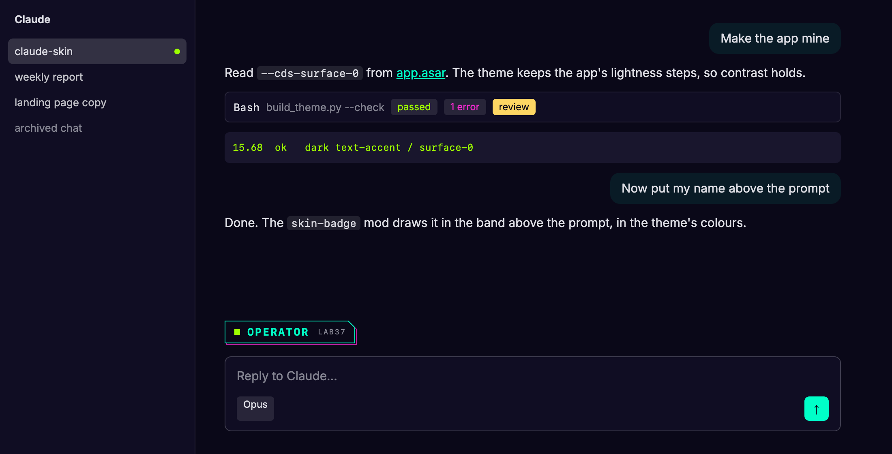
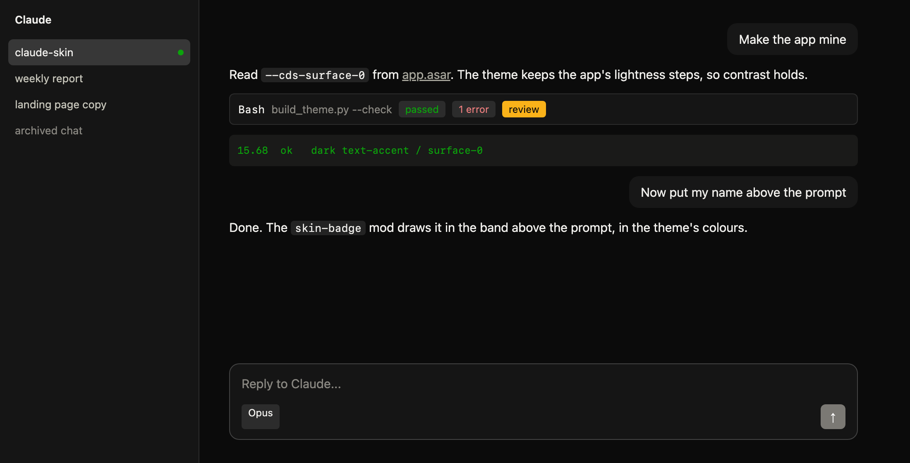
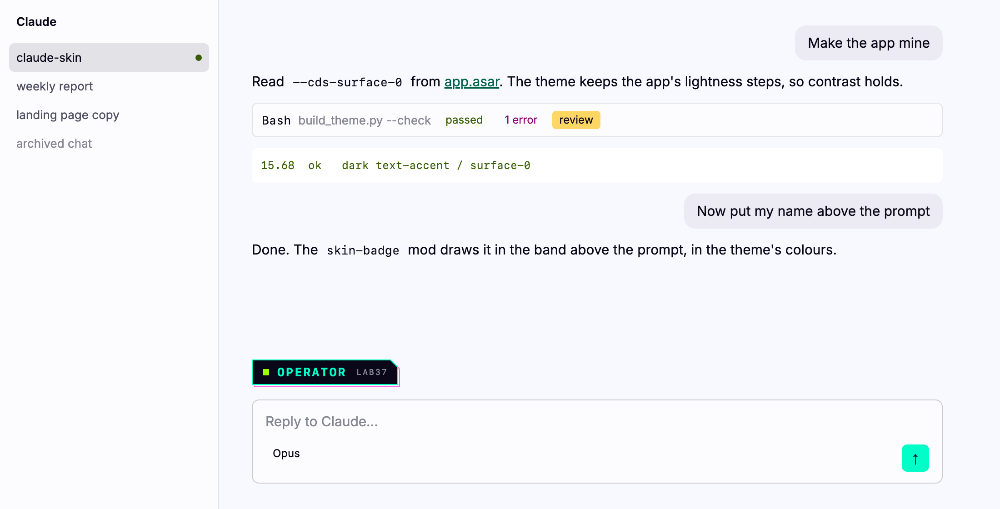

# claude-skin

Your colours in the Claude desktop app on macOS, and your name above the Claude Code prompt.

[](LICENSE)
[](#needs)
[](#let-claude-do-it)



| Stock | Same skin, light mode |
| --- | --- |
|  |  |

<sub>Rendered by `preview.py` from the app's own design tokens, the same CSS the installer paints in.</sub>

## Let Claude do it

Paste this into Claude Code and swap in your colours:

```text
Clone https://github.com/delarc0/claude-skin to ~/claude-skin, read its CLAUDE.md,
and skin my Claude app: background #1a1b26, accent #7aa2f7, font JetBrains Mono,
badge name ALEX with sub-label ACME.
```

Claude writes the theme, checks contrast, shows you a preview, and installs only after you say yes.
A brand name alone is not enough: give it the hex values or a page that lists them.

## What you get

- **A theme that stays readable.** `build_theme.py` reads the app's own `--cds-*` design tokens out of
  `/Applications/Claude.app` and repaints every colour ramp from a small JSON palette. Each step keeps
  the app's lightness, so contrast holds in dark and light mode. `--check` fails the build if any text
  or fill pair drops below WCAG AA (or, for the few pairs the app itself ships below AA, below the app).
- **Applied at every launch.** A LaunchAgent notices Claude starting and runs an AppleScript that opens
  DevTools in each window, pastes the theme into the Console and closes it. Before every keystroke it
  checks that Claude is in front, its front window is DevTools, and no Spotlight, Raycast or Alfred
  panel is open, and stops otherwise. It finds the menu item in all 43 languages the app ships.
- **A name badge.** `skin-badge` is a Claude Code mod that draws an SVG badge in the band above the
  prompt, in the theme's colours (plain text in the terminal). The installer draws it into its own copy,
  so your name never lands in your clone and `git pull` stays clean.

## Needs

macOS, the [Claude desktop app](https://claude.ai/download), [Claude Code](https://claude.com/claude-code)
and python3 (Command Line Tools: `xcode-select --install`). No other dependencies.

## By hand

```bash
git clone https://github.com/delarc0/claude-skin ~/claude-skin && cd ~/claude-skin
cp themes/lab37-cyberpunk.json themes/mine.json      # then edit the colours
python3 build_theme.py mine --check                  # contrast report, fails under WCAG AA
python3 preview.py mine --name YOURNAME             # open preview/mine.html
./install.sh mine --name YOURNAME --sub YOURTEAM
```

Then quit and reopen Claude. The first paint asks for Accessibility: allow it in System Settings,
Privacy and Security, Accessibility, then quit and reopen Claude once more. The skin appears a few
seconds after launch. `~/Library/Logs/local.claude-skin.log` says what happened.

## A theme

```json
{
  "label": "Tokyo night",
  "ground": { "hue": "#1a1b26" },
  "roles": { "accent": "#7aa2f7", "success": "#9ece6a", "danger": "#f7768e" },
  "fonts": { "mono": "JetBrains Mono" },
  "badge": {
    "name": "ALEX", "sub": "ACME",
    "fill": "#1a1b26", "stroke": "#7aa2f7", "ink": "#7aa2f7", "subInk": "#a9b1d6",
    "mark": "#9ece6a", "markShape": "square", "offset": null, "chamfer": false
  }
}
```

- `ground.hue` is the colour the greys lean toward. Pin exact surfaces with `deep` (page), `base`
  (sidebar) and `raised` (hover) if you want them.
- `roles` are `accent`, `success`, `danger` and `warning`. Leave one out and it keeps the app's own.
- `fonts.sans` and `fonts.mono` must be installed on your Mac; without them the app falls back to the
  system font.

Your own themes stay out of git. Every field is in [`skills/desktop-skin/SKILL.md`](skills/desktop-skin/SKILL.md).

## As a Claude Code plugin

```bash
claude plugin marketplace add delarc0/claude-skin
claude plugin install desktop-skin@desktop-skin
```

Then ask Claude to skin your app from any folder. The badge mod comes from `install.sh`, with your name in it.

## Limits

- It uses Developer Mode (`developer_settings.json` in Claude's settings folder) and DevTools. That is a
  supported Claude feature, but the theme sits on internal tokens: an app update can rename them. The
  build then fails loudly instead of shipping a broken skin; rebuild after updates.
- A window that fully reloads loses the skin until Claude's next launch.
- The Accessibility permission lets the program it is granted to control the keyboard. Remove it in
  System Settings if you uninstall.

## Uninstall

```bash
~/claude-skin/install.sh --uninstall
```

Removes the painter, the LaunchAgent and the badge mod. Developer Mode stays on; delete
`~/Library/Application Support/Claude/developer_settings.json` to turn it off.

## License

MIT, by [LAB37](https://lab37.io).
